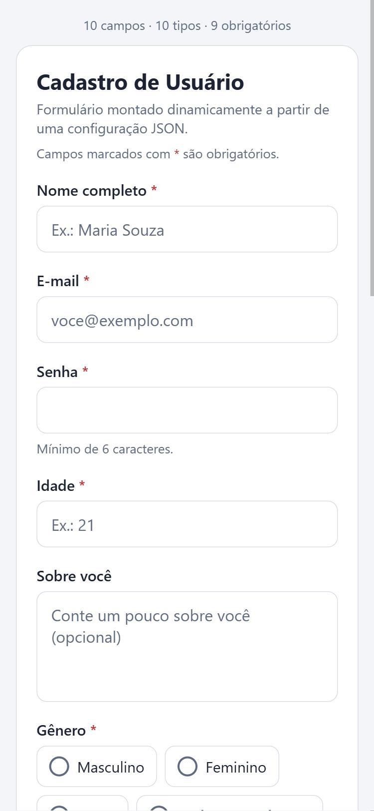
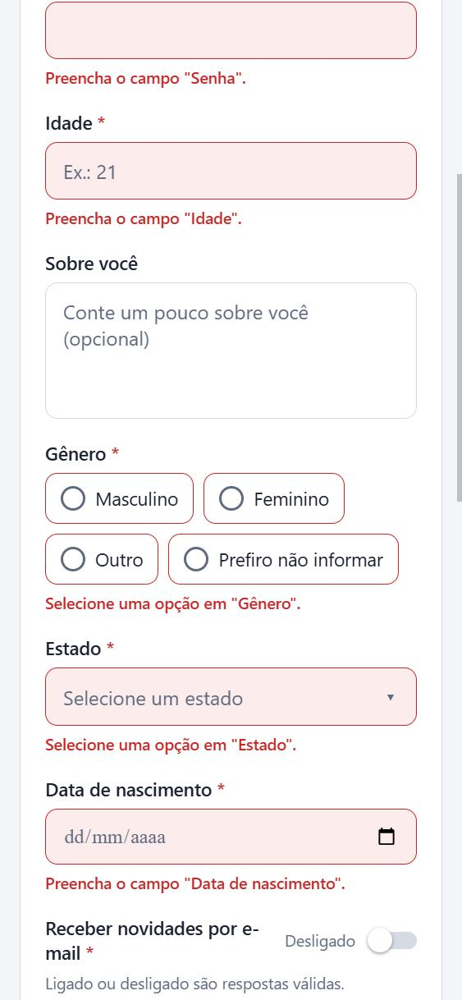

# 📱 CP3 Mobile — Formulário Dinâmico a partir de JSON

Aplicativo em **React Native + Expo SDK 55 + TypeScript** que monta um formulário **inteiramente a partir de uma configuração JSON**. Os campos, rótulos, tipos, opções e obrigatoriedade são definidos em [`src/config/formConfig.ts`](src/config/formConfig.ts) — a tela apenas percorre o array `fields` e escolhe o componente de cada campo pelo seu `type`.

As respostas são validadas, o resultado é exibido na interface e salvo localmente com **AsyncStorage**, sendo recuperado ao reabrir o app e podendo ser apagado pelo botão **"Limpar dados salvos"**.

## Integrantes

Arthur Gomes - RM 560771

Luiz Silva - RM 560110

Matheus Siroma - RM 560248

Pedro Estevam - RM 560642


## Tecnologias utilizadas

| Tecnologia | Versão | Uso |
|---|---|---|
| Expo SDK | 55 | Plataforma e ferramentas de execução |
| React Native | 0.83 | Interface (Android, iOS e Web via `react-native-web`) |
| React | 19.2 | Hooks `useState`, `useEffect`, `useMemo`, `useCallback` |
| TypeScript | 5.9 (modo `strict`) | Tipagem da configuração, campos, opções e valores — sem `any` |
| @react-native-async-storage/async-storage | 2.2 | Persistência local |
| @react-native-community/datetimepicker | 8.6 | Campo de data no Android e iOS |
| react-native-safe-area-context | 5.6 | Respeitar notch/barra de status |

## Como executar

Pré-requisitos: **Node.js 20.19+** (recomendado 22 LTS) e o app **Expo Go** (SDK 55) no celular, ou um emulador Android / simulador iOS.

```bash
git clone https://github.com/M-siroma/CP3-Mobile.git
cd CP3-Mobile
npm install
```

```bash
npx expo start          # abre o menu do Expo: leia o QR Code com o Expo Go, ou tecle "a" (Android) / "i" (iOS)
npx expo start --web    # abre a versão Web no navegador (ou tecle "w" no menu acima)
```

Verificação de tipos:

```bash
npm run typecheck
```

### Roteiro para verificar os requisitos

1. Toque em **Enviar cadastro** com o formulário vazio → cada campo obrigatório mostra a sua mensagem em vermelho e um aviso indica quantos campos estão pendentes. Nada é salvo.
2. Digite um e-mail inválido (ex.: `maria@`) ou uma senha com menos de 6 caracteres → a validação por tipo informa o problema.
3. Preencha todos os campos e envie → o card **"Resultado do último envio"** mostra cada valor identificado pelo rótulo do campo.
4. Feche e reabra o app (ou recarregue a página na Web) → o resultado continua lá, com o aviso "envio(s) recuperado(s) do armazenamento local".
5. Toque em **Limpar dados salvos** → a lista é apagada do AsyncStorage e da tela; ao reabrir, continua vazia.
6. Para provar que a tela é genérica: edite `src/config/formConfig.ts` (mude um `label`, adicione uma opção, troque a ordem, crie um novo campo) e o formulário muda sem alterar nenhum componente.

## Prints da aplicação

| Formulário gerado pelo JSON | Validação dos obrigatórios | Resultado salvo e recuperado |
|---|---|---|
|  |  |  |

## Como funciona

### Configuração JSON

```ts
export const formConfig: FormConfig = {
  title: 'Cadastro de Usuário',
  fields: [
    { id: 'name', label: 'Nome completo', type: 'text', required: true },
    { id: 'state', label: 'Estado', type: 'select', required: true,
      options: [{ label: 'São Paulo', value: 'SP' }, { label: 'Rio de Janeiro', value: 'RJ' }] },
    // ...um campo de cada um dos 10 tipos
  ],
};
```

`FieldConfig` é uma **união discriminada por `type`** ([`src/types/form.ts`](src/types/form.ts)): campos `select`/`radio` exigem `options`, campos de texto aceitam `placeholder`/`minLength`, o `switch` aceita `defaultValue` etc. O TypeScript impede configurações incoerentes.

### Renderização dinâmica

```tsx
{config.fields.map((field) => (
  <FieldRenderer key={field.id} field={field} value={values[field.id]} error={errors[field.id]} onChange={setFieldValue} />
))}
```

[`FieldRenderer`](src/components/fields/FieldRenderer.tsx) é o único ponto que conhece os tipos: faz um `switch (field.type)` e devolve o componente correspondente.

### Tipos de campo

| `type` | Componente | Comportamento |
|---|---|---|
| `text` | `TextInputField` | Texto em linha única |
| `email` | `TextInputField` | Teclado de e-mail, sem autocapitalização |
| `password` | `TextInputField` | `secureTextEntry` (caracteres ocultos) |
| `number` | `TextInputField` | Teclado numérico; aceita só dígitos, `,` `.` e `-` |
| `multiline` | `TextInputField` | Várias linhas |
| `select` | `SelectField` | Combo com `Modal` + `FlatList`, opções vindas de `options` |
| `radio` | `RadioField` | Opções exclusivas vindas de `options` |
| `checkbox` | `CheckboxField` | Caixa de marcação |
| `switch` | `SwitchField` | Ligado / desligado (`Switch` nativo) |
| `date` | `DateField` / `DateField.web` | Android: diálogo nativo · iOS: calendário em modal · Web: `<input type="date">` |

**Data em cada plataforma:** o `@react-native-community/datetimepicker` não tem suporte à Web, então o projeto fornece `DateField.web.tsx`. O Metro escolhe automaticamente o arquivo `.web.tsx` na Web e o `.tsx` no Android/iOS. Nas três plataformas o valor é armazenado como `AAAA-MM-DD` e exibido como `DD/MM/AAAA`.

### Regras de validação ([`src/utils/validation.ts`](src/utils/validation.ts))

| Tipo | Campo obrigatório é considerado respondido quando... | Validação adicional |
|---|---|---|
| text, multiline, password | tem texto (espaços não contam) | `minLength`, se configurado |
| email | tem texto | formato de e-mail |
| number | tem texto | precisa ser numérico |
| select, radio | uma opção foi escolhida | a opção precisa existir em `options` |
| checkbox | está **marcado** (ex.: aceite de termos) | — |
| switch | **sempre** — ligado (`true`) e desligado (`false`) são respostas válidas | — |
| date | uma data foi escolhida | data válida e não futura |

Os erros aparecem após a primeira tentativa de envio e são atualizados em tempo real enquanto o usuário corrige.

### Persistência ([`src/services/submissionStorage.ts`](src/services/submissionStorage.ts))

- Cada envio válido é adicionado a uma lista salva na chave `@cp3-mobile/submissions`.
- Ao abrir o app, `useEffect` lê a lista e a exibe (o último envio em destaque e os anteriores abaixo).
- Os dados lidos são validados com *type guards* antes do uso, então um valor corrompido não quebra o app.
- **Limpar dados salvos** executa `AsyncStorage.removeItem` e atualiza a tela.
- Por segurança, a **senha não é gravada em texto puro**: o resultado salvo guarda apenas `••••••••`, indicando que foi informada.

### Hooks

| Hook | Onde | Finalidade |
|---|---|---|
| `useState` | `useDynamicForm`, `useSubmissions`, `SelectField`, `DateField` | Valores do formulário, tentativa de envio, lista salva, status, modais |
| `useEffect` | `useSubmissions` | Carregar os dados do AsyncStorage ao abrir o app |
| `useMemo` | `useDynamicForm`, `SubmissionCard`, `SelectField`, `FormScreen` | Valores iniciais derivados da config, validação recalculada só quando os valores mudam, linhas do resultado, rótulo da opção selecionada, resumo dos campos |
| `useCallback` | `useDynamicForm`, `useSubmissions`, `DynamicForm`, `FormScreen` | Handlers estáveis (`setFieldValue`, `submit`, `addSubmission`, `clearAll`); com `FieldRenderer` memoizado, só o campo alterado é renderizado de novo |

## Estrutura de pastas

```text
CP3-Mobile/
├── App.tsx                         # Raiz: SafeAreaProvider + tela
├── index.ts                        # registerRootComponent
├── app.json                        # Configuração do Expo
├── docs/prints/                    # Prints usados neste README
└── src/
    ├── config/
    │   └── formConfig.ts           # JSON que define o formulário
    ├── types/
    │   └── form.ts                 # FormConfig, FieldConfig (união discriminada), FieldValue, Submission
    ├── components/
    │   ├── DynamicForm.tsx         # Percorre config.fields e controla o envio
    │   ├── SubmissionCard.tsx      # Exibe um envio (rótulo → valor)
    │   ├── Button.tsx
    │   └── fields/
    │       ├── FieldRenderer.tsx   # type → componente
    │       ├── FieldWrapper.tsx    # rótulo, *, ajuda e erro
    │       ├── TextInputField.tsx  # text, email, password, number, multiline
    │       ├── SelectField.tsx
    │       ├── RadioField.tsx
    │       ├── CheckboxField.tsx
    │       ├── SwitchField.tsx
    │       ├── DateField.tsx       # Android / iOS
    │       └── DateField.web.tsx   # Web
    ├── hooks/
    │   ├── useDynamicForm.ts       # Estado + validação do formulário
    │   └── useSubmissions.ts       # Sincronização com o AsyncStorage
    ├── services/
    │   └── submissionStorage.ts    # Leitura, gravação e limpeza no AsyncStorage
    ├── screens/
    │   └── FormScreen.tsx          # Formulário + resultados salvos
    ├── theme/
    │   └── colors.ts
    └── utils/
        ├── validation.ts           # Regras de validação por tipo
        ├── values.ts               # Valores iniciais, formatação e sanitização
        └── date.ts                 # Conversões de data sem erro de fuso
```
